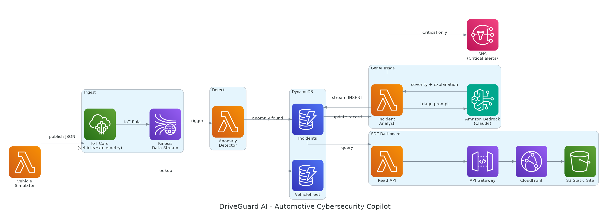

# DriveGuard AI 🚗🛡️

Real-time automotive cybersecurity SOC copilot — simulated connected-vehicle
telemetry is monitored for anomalies (CAN-bus injection signs, GPS spoofing,
unauthorized ECU access, malicious OTA sources), and **Amazon Bedrock
(Claude)** auto-triages every flagged event into a severity rating, a
plain-English explanation, and a recommended action for the SOC team.

Built entirely on serverless AWS services — no real vehicle hardware
required. Designed as a console-driven demo for an AWS Community Builder
tech talk / LinkedIn video.



## How it works

1. A scheduled Lambda simulates a small vehicle fleet, publishing telemetry
   to **AWS IoT Core**.
2. An IoT Rule routes messages into a **Kinesis Data Stream**.
3. An **Anomaly Detector** Lambda applies rule-based thresholds and writes
   flagged events to a **DynamoDB** `Incidents` table.
4. A DynamoDB Stream triggers the **Incident Analyst** Lambda, which calls
   **Amazon Bedrock** to triage the raw signal into severity + explanation +
   recommended action, written back to the same record.
5. Critical incidents publish to an **SNS** topic (e.g. email alert).
6. A **Read API** (API Gateway + Lambda) serves triaged incidents to a
   static **SOC dashboard** (S3 / CloudFront), which polls every 5 seconds.

## Repo structure

```
driveguard-ai/
├── architecture/
│   └── architecture-diagram.png     # AWS-icon architecture diagram
├── lambdas/
│   ├── simulator/lambda_function.py         # publishes fake telemetry
│   ├── anomaly_detector/lambda_function.py  # Kinesis-triggered rule engine
│   ├── incident_analyst/lambda_function.py  # Bedrock triage (the GenAI step)
│   └── read_api/lambda_function.py          # API Gateway handler
├── frontend/
│   └── index.html                   # single-file SOC dashboard
├── data/
│   ├── sample_data_vehiclefleet.json  # 8 fake VINs to seed VehicleFleet
│   └── sample_data_incidents.json     # 4 example triaged incidents
└── docs/
    └── driveguard-ai-demo-guide.md    # full step-by-step console build guide
```

## Deploy

Full click-by-click AWS console instructions — table creation, IAM
permissions, IoT Rule SQL, each Lambda's triggers/env vars, API Gateway
setup, and the on-camera demo script — are in
[`docs/driveguard-ai-demo-guide.md`](docs/driveguard-ai-demo-guide.md).

In short: DynamoDB tables → IoT Core + Kinesis → the four Lambdas (each
`lambda_function.py` here maps 1:1 to a console function) → API Gateway →
upload `frontend/index.html` to an S3 static site, paste your API URL into
the box at the top of the page.

## Requirements

- AWS account with **Bedrock model access** enabled for a Claude model.
- No local tooling required — this is built step-by-step in the AWS
  console (see the guide), so the Lambda files here are meant to be
  copy-pasted into the console code editor, not deployed via CLI/IaC.

## Cost

Everything is serverless and on-demand. A few demo runs cost cents. Tear
down the IoT Rule, Kinesis stream, and CloudFront distribution after
recording if you won't reuse them.

## License

MIT — see [`LICENSE`](LICENSE).
